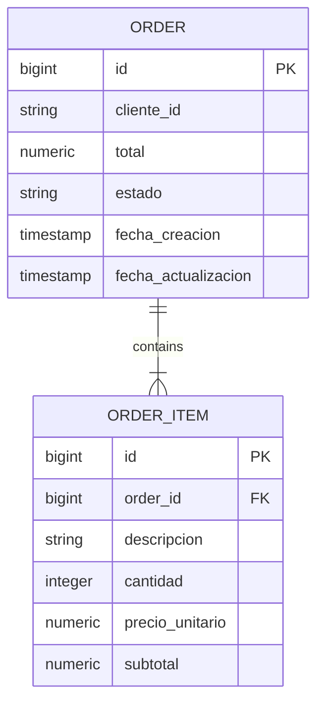
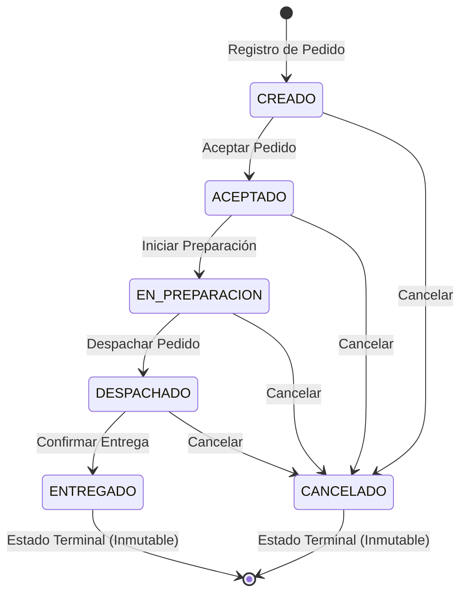

# Data Model: Microservicio de Pedidos (`ms_pedidos360_orders`)

**Feature**: CRUD de Pedidos y Ciclo de Vida (`001-orders-crud-lifecycle`)  
**Fecha**: 2026-09-03  
**Estado**: Diseñado

## 1. Diagrama Entidad-Relación y Estado





---

## 2. Entidades y Enumeraciones

### 2.1. `OrderStatus` (Enum)
Enumeración que representa los estados válidos dentro del ciclo de vida del pedido.

| Valor | Descripción | Terminal |
|---|---|---|
| `CREADO` | Pedido recién registrado en el sistema. | No |
| `ACEPTADO` | Pedido verificado y aprobado para inicio de procesamiento. | No |
| `EN_PREPARACION` | Pedido en proceso de empaquetado o preparación física. | No |
| `DESPACHADO` | Pedido entregado al transportista en ruta de entrega. | No |
| `ENTREGADO` | Pedido entregado exitosamente al cliente final. | Sí |
| `CANCELADO` | Pedido cancelado durante cualquier fase previa a la entrega. | Sí |

---

### 2.2. `Order` (Entidad JPA: `orders`)
Entidad raíz del agregado de pedidos.

| Atributo | Tipo Java | Tipo BD | Restricciones / Anotaciones | Descripción |
|---|---|---|---|---|
| `id` | `Long` | `BIGINT` | `@Id`, `@GeneratedValue(strategy = GenerationType.IDENTITY)` | Identificador numérico único del pedido. |
| `clienteId` | `String` | `VARCHAR(100)` | `@NotNull`, `@NotBlank`, `@Column(name = "cliente_id", nullable = false)` | Identificador del cliente que emite el pedido. |
| `items` | `List<OrderItem>` | Relación | `@OneToMany(mappedBy = "order", cascade = CascadeType.ALL, orphanRemoval = true)` | Colección de líneas de productos que componen el pedido. |
| `total` | `BigDecimal` | `NUMERIC(12,2)` | `@NotNull`, `@Positive`, `@Column(name = "total", nullable = false)` | Monto total acumulado del pedido. |
| `estado` | `OrderStatus` | `VARCHAR(30)` | `@NotNull`, `@Enumerated(EnumType.STRING)`, `@Column(name = "estado", nullable = false)` | Estado actual del pedido dentro de la máquina de estados. |
| `fechaCreacion` | `LocalDateTime` | `TIMESTAMP` | `@CreationTimestamp`, `@Column(name = "fecha_creacion", nullable = false, updatable = false)` | Marca temporal de alta del pedido. |
| `fechaActualizacion` | `LocalDateTime` | `TIMESTAMP` | `@UpdateTimestamp`, `@Column(name = "fecha_actualizacion", nullable = false)` | Marca temporal de la última actualización del pedido. |

---

### 2.3. `OrderItem` (Entidad JPA: `order_items`)
Representa cada ítem o producto contenido en un pedido.

| Atributo | Tipo Java | Tipo BD | Restricciones / Anotaciones | Descripción |
|---|---|---|---|---|
| `id` | `Long` | `BIGINT` | `@Id`, `@GeneratedValue(strategy = GenerationType.IDENTITY)` | Identificador numérico único del ítem. |
| `order` | `Order` | `BIGINT` (FK) | `@ManyToOne(fetch = FetchType.LAZY)`, `@JoinColumn(name = "order_id", nullable = false)` | Referencia al pedido al que pertenece este ítem. |
| `descripcion` | `String` | `VARCHAR(255)` | `@NotNull`, `@NotBlank`, `@Column(name = "descripcion", nullable = false)` | Detalle o nombre descriptivo del producto/servicio. |
| `cantidad` | `Integer` | `INTEGER` | `@NotNull`, `@Min(1)`, `@Column(name = "cantidad", nullable = false)` | Cantidad de unidades solicitadas. |
| `precioUnitario` | `BigDecimal` | `NUMERIC(12,2)` | `@NotNull`, `@Positive`, `@Column(name = "precio_unitario", nullable = false)` | Precio unitario del ítem. |
| `subtotal` | `BigDecimal` | `NUMERIC(12,2)` | `@NotNull`, `@Positive`, `@Column(name = "subtotal", nullable = false)` | Subtotal calculado (`cantidad * precioUnitario`). |

---

## 3. Matriz de Transiciones de la Máquina de Estados

La máquina de estados (`OrderStateMachine`) aplica la siguiente matriz de verificación determinista:

| Estado Origen (`from`) | Estados Destino Permitidos (`to`) | Excepción ante cualquier otro estado |
|---|---|---|
| `CREADO` | `ACEPTADO`, `CANCELADO` | `InvalidStateTransitionException` (409 Conflict) |
| `ACEPTADO` | `EN_PREPARACION`, `CANCELADO` | `InvalidStateTransitionException` (409 Conflict) |
| `EN_PREPARACION` | `DESPACHADO`, `CANCELADO` | `InvalidStateTransitionException` (409 Conflict) |
| `DESPACHADO` | `ENTREGADO`, `CANCELADO` | `InvalidStateTransitionException` (409 Conflict) |
| `ENTREGADO` | *Ninguno* (estado terminal inmutable) | `InvalidStateTransitionException` (409 Conflict) |
| `CANCELADO` | *Ninguno* (estado terminal inmutable) | `InvalidStateTransitionException` (409 Conflict) |

---

## 4. Repositorio de Acceso a Datos (`OrderRepository`)

Hereda de `JpaRepository<Order, Long>` con métodos para consultas y filtros:

```java
public interface OrderRepository extends JpaRepository<Order, Long> {
    
    List<Order> findByEstado(OrderStatus estado);
    
    List<Order> findByFechaCreacionBetween(LocalDateTime from, LocalDateTime to);
    
    List<Order> findByEstadoAndFechaCreacionBetween(OrderStatus estado, LocalDateTime from, LocalDateTime to);
}
```
*(Opcionalmente complementado con `JpaSpecificationExecutor<Order>` para consultas dinámicas combinadas).*
